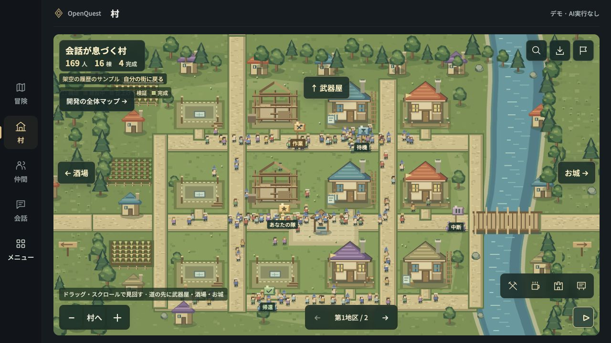
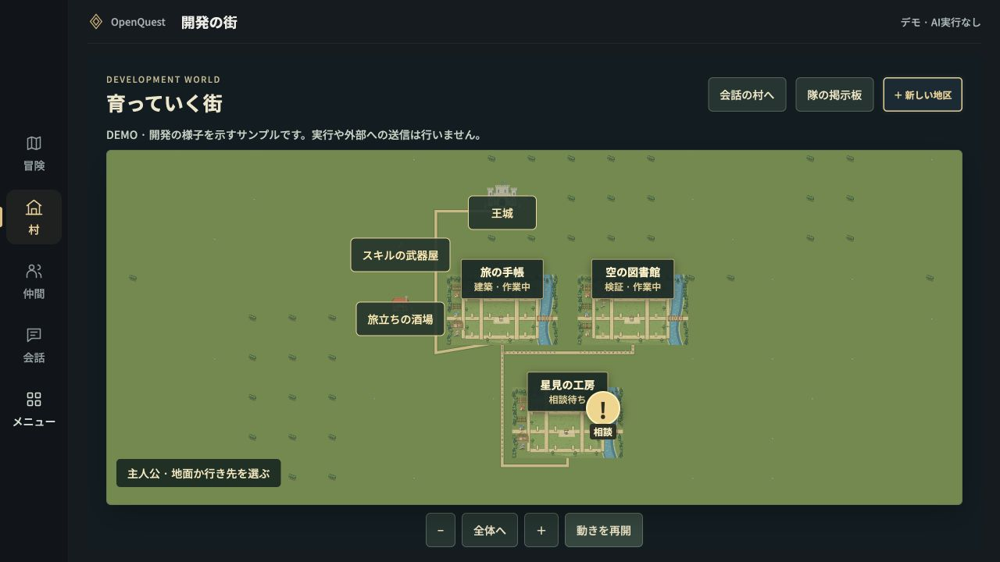

# Media / 動画・画像

**OpenQuest by Toppy · Research Preview**

## Application screenshots / 実アプリのデモ画面

Captured on **2026-11-07**, 1280 × 720, using the actual browser renderer and fictional sample data. Animation was paused using the application's control. These images were not drawn or generated as mockups.

**2026-11-07**撮影、1280×720。実際のブラウザ用画面コードと架空のサンプルデータを使用し、画面上の操作で動きを止めて撮影しました。描き起こしたイメージ画像ではありません。

The renderer was served from a local static preview and opened in an in-app browser. The application backend, Terminal, authentication, external services, and live AI were not used. These screenshots demonstrate the visible demo interface, not an end-to-end integration test.

ローカルの静的プレビューをアプリ内ブラウザで表示しています。アプリのバックエンド、Terminal、認証、外部サービス、実AIは使っていません。画面のデモ表示を確認する画像であり、一連の実接続を検証した証拠ではありません。

Caption: **“OpenQuest by Toppy — Actual demo interface · Sample data · No live AI”**.

日本語の注記：**「OpenQuest by Toppy — 実アプリのデモ画面・サンプルデータ・AI実行なし」**。

## Concept films / コンセプト動画

Both films are 45-second concept animations, 1280 × 720, 24 fps. They use fictional conversations, tasks, and repositories. They illustrate the intended experience, not a live application or provider-integration recording.

両版とも45秒・1280×720・24fpsのコンセプトアニメーションです。架空の会話・タスク・リポジトリを使い、目指す体験を描いています。実アプリの操作録画や実AI接続の検証録画ではありません。

| Edition | Video | Poster | Subtitles |
|---|---|---|---|
| 日本語 | [MP4](assets/promo/openquest-concept-45s-ja.mp4) | [JPEG](assets/promo/openquest-concept-45s-ja-poster.jpg) | [SRT](assets/promo/openquest-concept-45s-ja.srt) |
| English | [MP4](assets/promo/openquest-concept-45s-en.mp4) | [JPEG](assets/promo/openquest-concept-45s-en-poster.jpg) | [SRT](assets/promo/openquest-concept-45s-en.srt) |

Use the caption **“OpenQuest by Toppy — Research Preview · Concept animation”** beside a video player or link. 日本語では **「OpenQuest by Toppy — 開発中 · コンセプトアニメーション」** と併記してください。

The existing films are preserved without re-encoding. The publication filenames identify the language and concept status. Keep the [voice and music credits](CREDITS.md) with the films.

既存映像は再エンコードせず収録しています。公開用ファイル名で言語とコンセプト映像であることを示し、[音声・音楽クレジット](CREDITS.md)を添えています。
