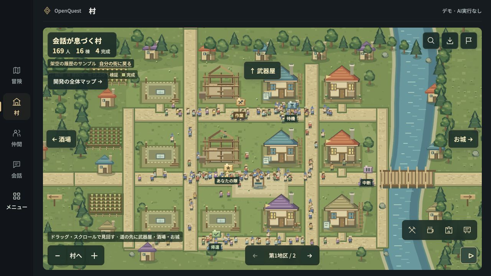

# OpenQuest

**[Toppy / ToppyMicroServices](https://www.toppymicros.com/) · Research Preview（開発中）**

**AIとの会話・作業・成果を、街として見渡すワークスペース。**

[English](README.md) · [現在の状態](STATUS.md) · [ロードマップ](ROADMAP.md) · [動画・画像](MEDIA.md) · [フィードバック](CONTRIBUTING.md)

AIと複数の調査や開発を進めていると、何を頼んだか、どこまで進んだか、どの成果を残したかが見えにくくなります。OpenQuestは、会話を仲間、プロジェクトを街、作業をクエストとして整理し、仕事の続きに戻りやすくする体験を開発しています。

個人の調査・開発に向けたローカルアプリの試作版です。このリポジトリでは製品の方向性と開発状況を紹介します。一般向けのアプリ配布、ホスト型サービス、実装ソースの提供はこのプレビューに含まれません。

## 目指す体験

- プロジェクト・会話・進み具合を地図で見渡す。
- 仲間や建物から、以前の会話・残された成果へ戻る。
- 仲間に役割を渡し、成果が次の作業につながる様子を追う。

試作版ではこの体験の一部を実装しています。デモでの動作と限定的な実AI検証は、[状態一覧](STATUS.md)に分けて記載しています。

## 試作版の実画面

2026-11-07に撮影した、実アプリのブラウザ用デモ画面です。架空のサンプルデータを使用しています。実際の画面コードを静的配信して撮影しており、撮影時にはアプリのバックエンドや実AIを起動していません。

[開発の全体マップを見る](assets/screenshots/project-map-demo.jpg) · [撮影条件](MEDIA.md)

## 45秒コンセプト動画

**目指す体験を描いたコンセプトアニメーションです。実アプリの操作録画ではありません。** 会話・タスク・リポジトリは架空例です。自動タスクの発生、テーマに応じた街の配置、新しい世界の生成は紹介用の演出を含みます。

[日本語45秒動画](assets/promo/openquest-concept-45s-ja.mp4) · [英語45秒動画](assets/promo/openquest-concept-45s-en.mp4) · [字幕・出典](MEDIA.md)

## 開発の現在地

| 項目 | 状態 |
|---|---|
| 画面の表現 | 俯瞰の2D地図と隊への追従。リーダーの目線による3D表示は、このプレビューでは未提供 |
| 街・会話・成果の表示 | 実装済み。サンプルデータでの確認記録あり |
| 仲間の役割順実行 | 実装済み。2026-10-15に4役割の短い実推論の記録あり |
| プロジェクト工程・並列処理 | 実装・隔離テスト済み。実アカウントでの幅広い評価は今後 |
| 実AIによる開発から実GitHubのPR作成まで | 全経路は未検証 |
| クラウド同期、複数ユーザー向けサービス、アプリ停止中の繰り返し予約 | 未実装 |
| 一般向けアプリ配布 | このプレビューでは未提供 |

詳しい範囲は[STATUS.md](STATUS.md)、次に確認する内容は[ROADMAP.md](ROADMAP.md)に記載します。更新日：**2026-11-07**。

## フィードバック

整理したい仕事、分かりにくい点、見たい操作例を、このリポジトリの **Issues** からお知らせください。[投稿案内](CONTRIBUTING.md)をご覧ください。

[クレジット](CREDITS.md) · [資料の利用について](USAGE.md) · [Toppy](https://www.toppymicros.com/)
