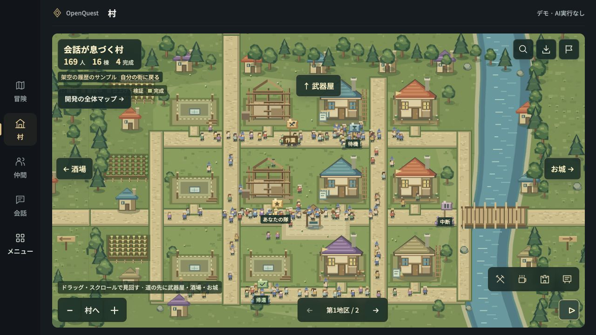
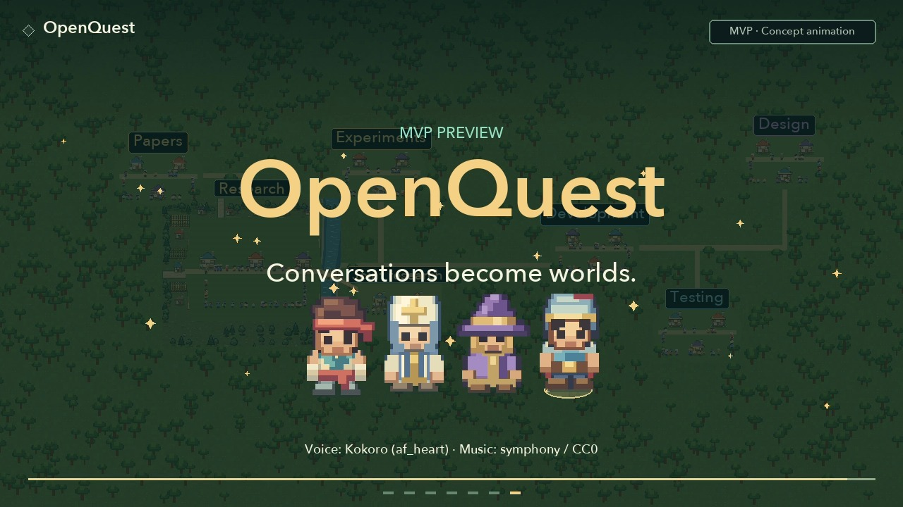

# OpenQuest

**By [Toppy / ToppyMicroServices](https://www.toppymicros.com/) · Research Preview · In development**

**A workspace that brings AI conversations, tasks, and outcomes into view as a growing town.**

[日本語](README.ja.md) · [Development status](STATUS.md) · [Roadmap](ROADMAP.md) · [Media](MEDIA.md) · [Feedback](CONTRIBUTING.md)

When you work with AI on several research or development projects, it becomes hard to remember what you asked, what is still running, and which results are worth returning to. OpenQuest explores a more visible way to organize that work: conversations become companions, projects become towns, and tasks become quests.

OpenQuest is a local application in development for individuals working with AI. This repository introduces the product and its progress. A public app download, hosted service, and implementation source are not included in this preview.

## The intended experience

- See projects, conversations, and their progress together on a map.
- Open a companion or building to return to a conversation or result.
- Give collaborators roles and follow how their outputs connect.

The prototype implements parts of this experience. Demo behavior and limited live checks are described separately in the [status table](STATUS.md); this is not a promise that every depicted workflow is ready for use.

## Prototype screenshots

Actual OpenQuest browser demo, captured on 2026-11-07 with fictional sample data. These show the real renderer served as static files; the application backend and live AI were not running during capture.

[Development map screenshot](assets/screenshots/project-map-demo.jpg) · [Capture context](MEDIA.md)

## 45-second concept film

**Concept animation — fictional examples, not an application recording.** Automatic task creation, thematic town placement, and world growth illustrate the direction of the product.

[English film](assets/promo/openquest-concept-45s-en.mp4) · [Japanese film](assets/promo/openquest-concept-45s-ja.mp4) · [Subtitles and credits](MEDIA.md)

## Where development stands

| Area | Status |
|---|---|
| Visual presentation | Overhead 2D maps with party tracking; a leader-perspective 3D view is not available in this preview |
| Town, conversation, and result views | Implemented in the local prototype; sample-data checks recorded |
| Role-based sequential collaboration | Implemented; a small four-role live inference check was recorded on 2026-10-15 |
| Project stages and parallel work | Implemented and tested with isolated substitutes; broader live evaluation remains |
| Real AI development through to a real GitHub pull request | Full path not yet verified |
| Cloud sync, hosted multiuser service, recurring work while the app is closed | Not implemented |
| General app distribution | Not available in this preview |

See [STATUS.md](STATUS.md) for the limits of those checks and [ROADMAP.md](ROADMAP.md) for next steps. Last updated: **2026-11-07**.

## Follow and contribute feedback

Use this repository's **Issues** tab to describe the work you would like to organize, what you find confusing, or which workflow you want to see demonstrated. Please follow the [feedback guide](CONTRIBUTING.md).

[Credits](CREDITS.md) · [Use of these materials](USAGE.md) · [Toppy](https://www.toppymicros.com/)
